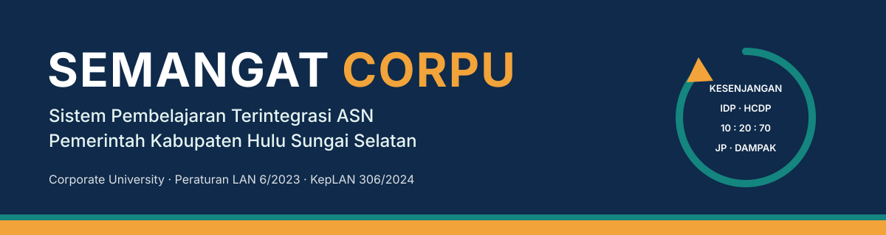
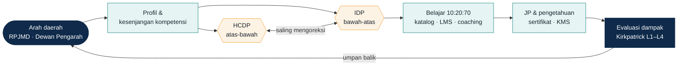
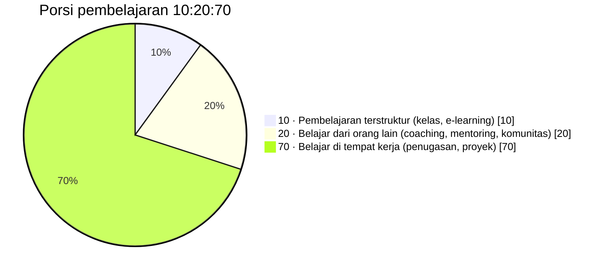
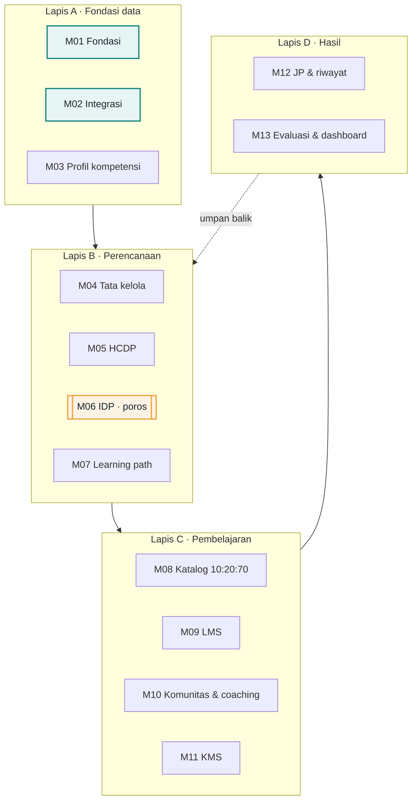
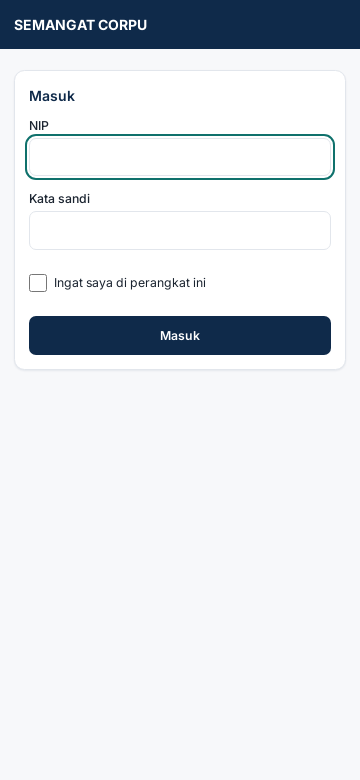
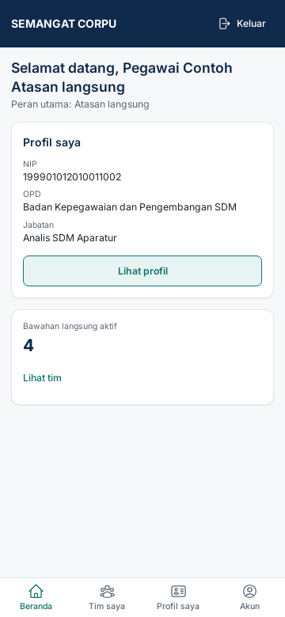
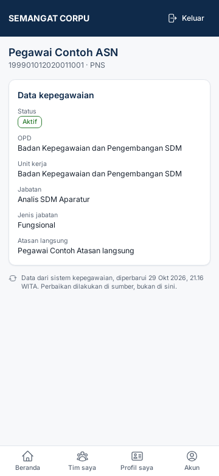
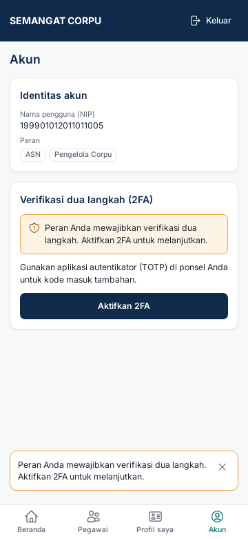
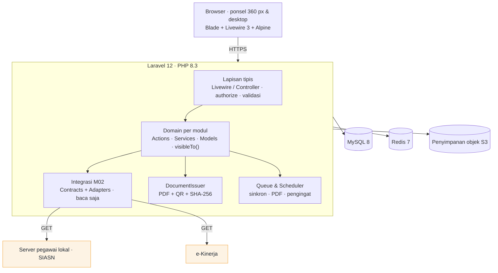
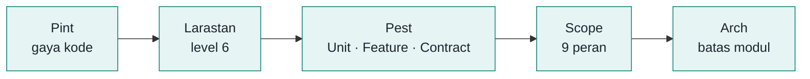

<p align="center">
  
</p>

<p align="center">
  <strong>Sistem operasi pembelajaran ASN, bukan sekadar LMS.</strong><br>
  Dari kesenjangan kompetensi ke IDP, dari belajar 10:20:70 ke JP, dari JP ke dampak nyata di tempat kerja.
</p>

<p align="center">
  <a href="LICENSE"></a>
  
  
  
  
  
  
</p>
<p align="center">
  
  
  
  
  
  
</p>

<p align="center">
  <a href="#mengapa-semangat-corpu">Mengapa</a> ·
  <a href="#siklus-pembelajaran">Siklus</a> ·
  <a href="#13-modul-dalam-4-lapis">Modul</a> ·
  <a href="#peta-jalan--status">Peta jalan</a> ·
  <a href="#tangkapan-layar">Tangkapan layar</a> ·
  <a href="#mulai-cepat">Mulai cepat</a> ·
  <a href="#dokumentasi">Dokumentasi</a>
</p>

---

## Sekilas

**SEMANGAT CORPU** adalah aplikasi web *Corporate University* bagi seluruh ASN (PNS & PPPK) Pemerintah Kabupaten Hulu Sungai Selatan. Aplikasi ini menjalankan siklus pengembangan kompetensi menurut **Peraturan LAN 6/2023** dan **KepLAN 306/2024** dalam satu sistem: profil kompetensi → IDP/HCDP → belajar 10:20:70 → JP → evaluasi dampak. Aplikasi dirancang ulang dari nol untuk menggantikan CORPU, LMS, dan KMS lama.

<table>
  <tr>
    <td align="center" width="20%"><h3>13</h3>modul terpadu</td>
    <td align="center" width="20%"><h3>102</h3>kebutuhan terlacak<br><sub><code>FON-01</code>…<code>EVA-10</code></sub></td>
    <td align="center" width="20%"><h3>9</h3>peran dengan<br>cakupan data teruji</td>
    <td align="center" width="20%"><h3>20 JP</h3>target tahunan<br>per ASN</td>
    <td align="center" width="20%"><h3>360 px</h3>layak di ponsel<br>untuk pegawai & atasan</td>
  </tr>
</table>

## Mengapa SEMANGAT CORPU

Hari ini, pengembangan kompetensi ASN sering kali:

| Masalah | Jawaban SEMANGAT CORPU |
|---|---|
| Disusun dari kalender diklat, bukan dari **kesenjangan** | Mesin kesenjangan SKJ vs level aktual, dan setiap angka diberi label keyakinan |
| Hanya kelas yang tercatat; porsi **20 dan 70** hilang | Katalog 10:20:70: coaching, penugasan, dan proyek kerja ikut dihitung JP |
| Data pegawai, SKP, SKJ, asesmen, dan riwayat bangkom **tercerai** | Satu sumber kebenaran lewat integrasi baca: sumber menang, tanpa salinan yang bersaing |
| **Dampak** tidak terukur | Evaluasi Kirkpatrick L1–L4 dengan pengingat L3 otomatis T+3 bulan |
| Tata kelola Corpu **hanya di atas kertas** | Registri SK, forum 3 level, dan pelacak keputusan |

### Lima prinsip yang tidak bisa ditawar

1. **IDP adalah poros.** Semua modul bermuara ke dan berangkat dari Rencana Pengembangan Individu.
2. **SKP dibaca, tidak ditulis.** Arus data satu arah dari e-Kinerja; aplikasi tidak pernah menulis ke e-Kinerja dan tidak menyimpan predikat kinerja.
3. **Pembelajaran bukan RHK.** Pembelajaran masuk SKP lewat perilaku "Kompeten" dengan bukti dukung PDF ber-QR: Rencana Pembelajaran di awal periode dan Laporan Hasil Pembelajaran di akhir periode.
4. **Data jujur.** Setiap data kompetensi berlabel *Terverifikasi*, *Sementara*, atau *Indikatif*, dibedakan dengan pola dan ikon, bukan warna saja.
5. **Tata kelola mewajibkan, aplikasi melayani.**

## Siklus pembelajaran



### Model 10:20:70

Sebagian besar pembelajaran terjadi di tempat kerja. SEMANGAT CORPU mencatat ketiga porsinya, bukan hanya kelas.



## 13 modul dalam 4 lapis



<sub>Hijau-teal = sudah dibangun (F1). Oranye = modul poros.</sub>

## Peta jalan & status

Setiap fase adalah *vertical slice* (migrasi → Action/Service → antarmuka Livewire → tes) yang bisa didemokan kepada pengguna nyata. **MVP = F1–F4.**

| Fase | Hasil yang bisa didemokan | Status |
|---|---|---|
| **F1** Fondasi & data pegawai | Impor pegawai, login NIP, atasan otomatis, cakupan data 9 peran, 2FA, audit, verifikasi QR, panel kesehatan integrasi |  |
| **F2** Profil & kesenjangan | SKJ, level aktual, kesenjangan berlabel keyakinan, asesmen mandiri divalidasi atasan |  |
| **F3** IDP poros | Draf IDP otomatis, tautan SKP, persetujuan massal, Rencana Pembelajaran PDF ber-QR, check-in, penutupan |  |
| **F4** JP & laporan | Saldo 20 JP, verifikasi sertifikat luar, Laporan Hasil Pembelajaran PDF |  |
| F5 Katalog, path & LMS | Katalog 10:20:70, kelas e-learning, presensi QR, sertifikat otomatis |  |
| F6 Evaluasi & dashboard | L1/L2 otomatis, pengingat L3 T+3 bln, dashboard berjenjang |  |
| F7 Tata kelola & HCDP | Registri SK, forum 3 level, HCDP OPD → kabupaten → pengesahan |  |
| F8 Sosial & pengetahuan | Komunitas praktik, coaching (catatan rahasia), KMS dengan kurasi |  |

<sub>Tahapan final berstatus usulan sampai keputusan Q-11 (<a href="docs/03_ROADMAP.md">docs/03_ROADMAP.md</a>).</sub>

### Yang sudah berjalan di F1

| Kebutuhan | Kemampuan |
|---|---|
| `FON-01` | Login dengan **NIP + kata sandi**; akun pegawai nonaktif ditolak; beranda menyesuaikan peran utama |
| `FON-02` `FON-03` | **9 peran**. Peran *ASN* dan *atasan* diturunkan otomatis dari data jabatan; penugasan lain wajib beralasan dan teraudit |
| `FON-04` | **Cakupan data** sendiri / tim / OPD / kabupaten. Data di luar cakupan menghasilkan 404 dan diuji untuk setiap peran |
| `FON-05` | **Jejak audit tak dapat diubah**; pembukaan data rinci sensitif wajib izin dan alasan |
| `FON-06` | **2FA TOTP wajib** bagi pengelola, CLO, administrator teknis, dan auditor |
| `FON-09` | **Verifikasi dokumen publik** `/verifikasi/{uuid}`: jenis, pemilik, tanggal, status, dan sidik SHA-256, tanpa membuka isi dokumen |
| `INT-01` `INT-03` | **Sinkron & impor pegawai/unit/jabatan** (API server pegawai atau berkas XLSX/CSV). Idempoten; satu baris rusak membuat seluruh berkas ditolak dengan laporan per baris |
| `INT-08` | **Panel kesehatan integrasi**: sinkron terakhir, jumlah gagal, antrean ulang |

## Tangkapan layar

Mobile-first di lebar 360 px. Semua data pada gambar adalah data contoh fiktif.

<table>
  <tr>
    <td align="center"><br><sub>Masuk dengan NIP</sub></td>
    <td align="center"><br><sub>Beranda atasan</sub></td>
    <td align="center"><br><sub>Profil dari data sumber</sub></td>
    <td align="center"><br><sub>2FA wajib peran istimewa</sub></td>
  </tr>
</table>

## Arsitektur

Monolit modular: satu basis kode Laravel dengan 13 modul berbatas tegas di `app/Modules/<Modul>`. Pilihan ini cocok untuk tim kecil dan pemasangan di server milik pemda.



| Keputusan | Alasan |
|---|---|
| Monolit modular, bukan microservice | Tim kecil, dipasang di server pemda |
| Livewire, bukan SPA | Satu deployable, tanpa API internal ganda |
| Kontrak SKP tanpa metode tulis | Arus satu arah dijamin oleh tipe data, bukan sekadar disiplin |
| Kesenjangan dimaterialisasi | Dashboard dan agregasi OPD tetap cepat |
| Semua PDF lewat satu `DocumentIssuer` | QR, hash, dan registri verifikasi seragam |

## Keamanan & pelindungan data pribadi

Aplikasi ini mengelola data pribadi ASN, sehingga keamanan dibangun ke dalam lapisan yang dapat diuji, bukan hanya ditulis sebagai kebijakan.

- **Otorisasi dua lapis di setiap request**: Policy untuk aksi, ditambah scope `visibleTo($user)` untuk data. Kebocoran data diuji untuk semua 9 peran (`tests/Scope`).
- **Jejak audit append-only** untuk baca/tulis data sensitif; baris audit ditolak bila hendak diubah atau dihapus.
- **2FA wajib** untuk peran istimewa; batas percobaan login per NIP + IP.
- **Patuh UU 27/2022 (PDP)**: data hanya untuk pengembangan kompetensi; evaluasi individu tidak dipakai untuk penilaian kinerja; tidak ada data pribadi ke layanan AI/analitik eksternal.
- **Tes arsitektur sebagai pagar**: hanya adaptor yang boleh memanggil sistem luar; peran hanya ditetapkan oleh satu Action; keluaran HTML mentah dilarang.

## Teknologi

| Lapisan | Teknologi |
|---|---|
| Bahasa & framework | PHP 8.3 · Laravel 12 |
| Antarmuka | Livewire 3 · Alpine.js · Tailwind CSS 4 · Heroicons · Inter (di-host sendiri) |
| Data | MySQL 8.0 (kompatibel MariaDB 10.11) · Redis 7 · penyimpanan objek S3 |
| Autentikasi & peran | Laravel Fortify (2FA TOTP) · spatie/laravel-permission |
| Berkas | openspout (XLSX/CSV) · dompdf + QR (mulai F3) |
| Mutu | Pest 3 · Larastan level 6 · Laravel Pint |
| Dev lokal | Docker Compose / Laravel Sail · Mailpit |

## Mulai cepat

**Prasyarat:** Docker Engine + Compose v2, dan Git.

```bash
git clone https://github.com/Syamsuddin/SEMANGAT.git
cd SEMANGAT
cp .env.example .env

# Pasang dependensi PHP lewat container (tidak perlu PHP di host)
docker run --rm -u "$(id -u):$(id -g)" -v "$PWD":/var/www/html -w /var/www/html \
  -e COMPOSER_HOME=/tmp/c laravelsail/php83-composer:latest composer install

# Jalankan layanan: aplikasi, MySQL, Redis, Mailpit
export WWWUSER=$(id -u) WWWGROUP=$(id -g)
./vendor/bin/sail up -d --build

./vendor/bin/sail artisan key:generate
./vendor/bin/sail artisan migrate --seed

# Bangun aset antarmuka
docker run --rm -u "$(id -u):$(id -g)" -v "$PWD":/app -w /app node:20-alpine \
  sh -c "npm ci && npm run build"
```

Buka **http://localhost:8000**.

> [!TIP]
> **GitHub Codespaces:** isi `APP_URL` dengan alamat port 8000 yang diteruskan (`https://<nama-codespace>-8000.app.github.dev`) dan `TRUSTED_PROXIES=*` di `.env`. Bila koneksi antar-container diblokir, arahkan `DB_HOST`, `REDIS_HOST`, dan `MAIL_HOST` ke `host.docker.internal`. Rinciannya ada di [docs/10_DEV_ENV.md](docs/10_DEV_ENV.md).

### Akun contoh (hanya lingkungan dev)

Seeder membuat satu akun per peran dengan NIP fiktif berawalan `1999` dan kata sandi `semangat-dev-2026`.

| Peran | NIP | Catatan |
|---|---|---|
| ASN | `199901012020011001` | |
| Atasan langsung | `199901012010011002` | memiliki 4 bawahan |
| Koordinator OPD | `199901012012011003` | cakupan 1 OPD |
| Pengelola Corpu | `199901012011011005` | wajib 2FA |
| Auditor | `199901012016011009` | wajib 2FA |

Daftar lengkap ada di [database/seeders/DevUserSeeder.php](database/seeders/DevUserSeeder.php).

> [!IMPORTANT]
> Lingkungan dev dan uji tidak boleh memakai data produksi asli. Semua data contoh berasal dari factory/seeder.

## Perintah penting

| Tujuan | Perintah |
|---|---|
| Tes semua | `./vendor/bin/sail artisan test` |
| Gerbang pra-commit | `./vendor/bin/sail php vendor/bin/pint --test && ./vendor/bin/sail php vendor/bin/phpstan analyse && ./vendor/bin/sail artisan test --parallel` |
| Uji kebocoran data per peran | `./vendor/bin/sail artisan test --group=scope` |
| Tes arsitektur | `./vendor/bin/sail artisan test --group=arch` |
| Impor pegawai dari berkas | `./vendor/bin/sail artisan semangat:sync employees --file=<path.xlsx>` |
| Worker queue | `./vendor/bin/sail artisan queue:work redis --queue=default,documents,sync` |
| Validasi blueprint | `bash scripts/validate.sh` |

Daftar lengkapnya ada di [docs/11_COMMANDS.md](docs/11_COMMANDS.md).

## Struktur proyek

```
app/
  Modules/
    Fondasi/      M01 · auth, peran, audit, verifikasi dokumen
    Integrasi/    M02 · Contracts, Adapters, sinkron, panel kesehatan
    …             M03–M13 dibangun bertahap sesuai peta jalan
  Support/        lintas modul: AuditLogger, DataScope (visibleTo)
resources/
  css/app.css     token desain (@theme) — satu-satunya rumah nilai warna/ukuran
  views/          layout & komponen UI bersama
tests/
  Unit/ Feature/ Scope/ Arch/ Contract/ Fixtures/
docs/             blueprint 00–26 + sumber rancang bangun
```

## Pengujian & gerbang mutu



- **Nama tes memuat ID kebutuhan** (mis. `it('FON-04 …')`), sehingga setiap kebutuhan dapat ditelusuri ke tesnya.
- Tes berjalan di **MySQL sungguhan** (`semangat_test`), bukan SQLite, agar perilaku sama dengan produksi.
- Tidak ada request keluar tanpa `Http::fake()`.

## Dokumentasi

Pengembangan mengikuti blueprint di folder [`docs/`](docs/), yang diturunkan dari *SEMANGAT CORPU Rancang Bangun v0.1*.

| Dokumen | Isi |
|---|---|
| [00 Executive Summary](docs/00_EXECUTIVE_SUMMARY.md) | Masalah, solusi, prinsip |
| [01 PRD](docs/01_PRD.md) · [Katalog kebutuhan](docs/_sumber/KEBUTUHAN.md) | 13 modul dan 102 kebutuhan |
| [02 Scope](docs/02_SCOPE.md) · [03 Roadmap](docs/03_ROADMAP.md) | Batas cakupan, fase F1–F8 |
| [05 Peran](docs/05_USER_ROLE.md) · [07 Data model](docs/07_DATA_MODEL.md) | Matriks akses, skema |
| [08 Arsitektur](docs/08_ARCHITECTURE.md) · [21 Keamanan](docs/21_SECURITY_RULES.md) | Pola teknis, aturan keamanan |
| [23 Kriteria terima](docs/23_ACCEPTANCE_CRITERIA.md) · [24 Definisi selesai](docs/24_DEFINITION_OF_DONE.md) | Patokan selesai |
| [26 Konvensi UI](docs/26_UI_CONVENTIONS.md) | Token desain, komponen, aksesibilitas |
| [Panduan pengguna](docs/user/) | Ringkasan per peran |

## Berkontribusi

1. Baca [`CLAUDE.md`](CLAUDE.md) dan [`INDEX.md`](INDEX.md), lalu dokumen yang relevan dengan tugas Anda.
2. Pastikan tugas tercakup di [docs/02_SCOPE.md](docs/02_SCOPE.md). Bila di luar cakupan, tanyakan dulu.
3. Buat branch `feat/<fase>-<modul>-<ringkas>` atau `fix/<modul>-<ringkas>`.
4. Tulis commit dengan format *Conventional Commits* beserta ID kebutuhan, mis. `feat(idp): persetujuan massal atasan (IDP-04)`.
5. Pastikan gerbang pra-commit hijau, lalu ajukan PR dengan daftar ID kebutuhan dan tangkapan layar 360 px untuk UI pegawai/atasan.

Migrasi destruktif, perubahan akses atau enkripsi, dan rilis selalu melewati persetujuan manusia ([docs/22_CHANGE_POLICY.md](docs/22_CHANGE_POLICY.md)).

## Lisensi

Dirilis di bawah [Lisensi MIT](LICENSE). © 2026 Syamsuddin, S.Pd, MM, GCIO.

---

<p align="center">
  <sub>Dirancang oleh Bidang PSDM · BKPSDM Kabupaten Hulu Sungai Selatan<br>
  untuk ASN yang terus belajar dan melayani lebih baik.</sub>
</p>
